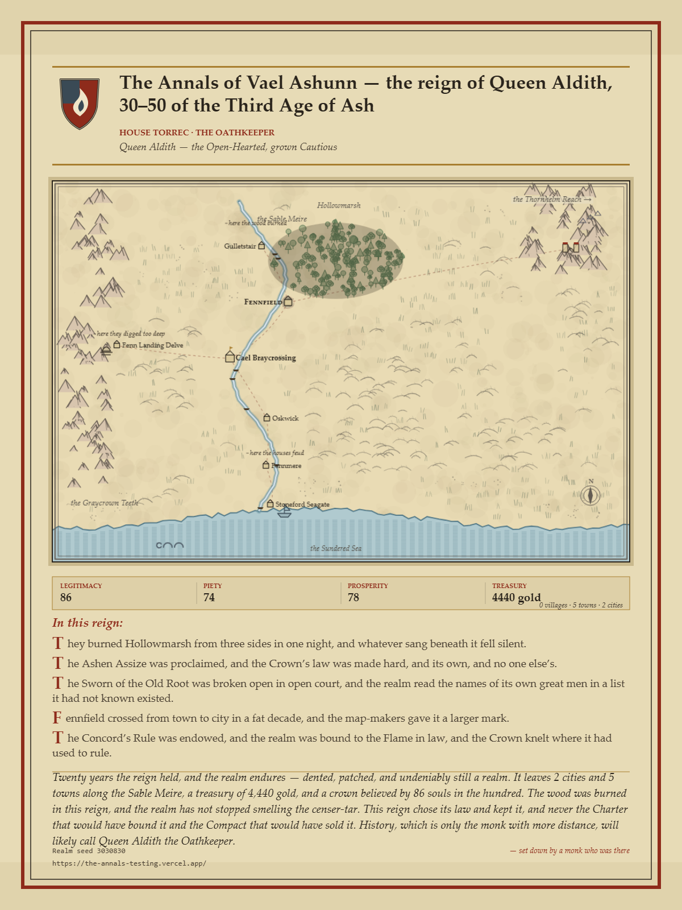

# The Cold Chair

**[Play it in your browser →](https://the-cold-chair-preview.conor-afe.workers.dev/)**

**Current release: v0.78.1.**

A medieval chronicle-strategy game in one self-contained page, plus a small offline worker. You take the Cold Chair of a
river realm and hold it for twenty years if you can — taxes, tolls, works of stone and
water, a scheming council, hidden societies, wars you fund but never command, dragons your
treasury attracts, and estates that keep score. Everything that happens is written down by
**a monk who was there and has opinions** — and who can be bribed, corrected by a later
hand, or shamed past writing at all. Every reign ends by composing **the Last Leaf**: one
illuminated manuscript page of your twenty years, downloadable and shareable.

## The iron law

The whole game is a pure function of a **seed** and your **action log**. There is no other
save format: the *history link* the game gives you replays your exact reign, choice for
choice, on any machine. Cheating is impossible to hide and history is negotiable only in
the telling — which is the theme, so it worked out.

## How to play

Open `index.html` (or the play link). Choose a hand: **the Crown** (rule), the
**Minor-Noble climb** (marry, steward, or usurp your way up), or an **Ill-Made Crown**
(curated predicaments already in trouble). Pick the weight of the chair — Kind, Cold, or
Iron — read your letters, and mind the margins: the monk's asides are load-bearing.

- The **chronicle** is the game. Read it. It is not always telling you the truth, and the
  ways it lies are information.
- The **Four Powers** (court, church, commons, the world) remember everything; so do your
  creditors, your councillors, and the losing side of any judgment you seal.
- A reign survived to year fifty passes to your heir — schooled or not, with the realm's
  debts and scars intact. The House is the long game.
- The realm has three views. The **Table** is a raised model, the **Ink map** is the
  chronicler's own chart, and the **Diorama** is a lit 3D model you can lean into, down to a
  single street, where the wars you fund can be watched as they march and clash. Full screen
  plays the whole reign from inside it.

## Running the tests

`bash tests/run-all.sh` regenerates `game.js` and runs every suite. The two real-browser
smokes run too once Playwright is installed (`npm i playwright --no-save && npx playwright
install chromium`); without it they say they were skipped.

## Running it headless

First extract the sim from the single file (once, and after any change):
`sed -n '/^<script>$/,/^<\/script>$/p' index.html | sed '1d;$d' > game.js`

`node harness.js <seed> <planFile|-> <untilWeek> [--auto=N]` drives the sim without a
browser (plans are JSON action lists; see `tests/plans/`). `tests/` holds the assertion
suites — every system ships with one, and a same-plan replay is byte-identical by
construction. Agents can play via `window.annals` (state / choices / choose / build …).

## Credits

Inspired by [emollick/annals-kingdom](https://github.com/emollick/annals-kingdom) —
renamed and long since diverged, so the lineage reads as a credit rather than a copy.
Built with heavy AI assistance; the monk's opinions are his own.

## License

See `LICENSE`.
